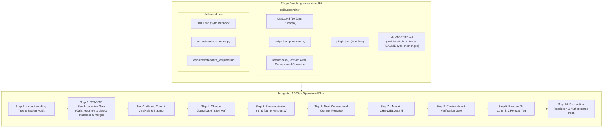

# Git & Release Toolkit (`git-release-toolkit`)

<p align="center">
  <strong>Unified Antigravity plugin for Git commit hygiene, automated Semantic Versioning, README synchronization, secret leak prevention, and authenticated remote push management.</strong>
</p>

<p align="center">
  <a href="#-overview">Overview</a> •
  <a href="#-bundled-components">Bundled Components</a> •
  <a href="#-architecture--pipeline">Architecture</a> •
  <a href="#-installation--setup">Installation</a> •
  <a href="#-usage--examples">Usage</a> •
  <a href="#-cli-tools">CLI Tools</a> •
  <a href="#-environment--security">Security</a> •
  <a href="#-license">License</a>
</p>

<p align="center">
  
  
  
  
  
  
</p>

---

## 🌟 Overview

**Git & Release Toolkit** is an all-in-one Antigravity plugin engineered to transform AI pair programming and development workflows into rigorous, production-grade release pipelines.

It solves three critical pain points in agentic software engineering:
1. **Documentation Drift**: Code modifications often ship without matching updates to `README.md` files.
2. **Monolithic & Unstructured Commits**: Disparate features, bug fixes, and configuration changes frequently get mixed into opaque commits.
3. **Accidental Credential Exposure**: Sensitive keys, certificates, or `.env` files can leak into public Git histories.

By uniting **`committer`** (atomic staging, Conventional Commits, SemVer, remote auth push), **`readme-r`** (change-driven contextual documentation synchronization), and an **ambient enforcement rule (`rules/AGENTS.md`)**, this toolkit ensures every release is documented, atomic, tested, and secure.

---

## 📦 Bundled Components

| Component | Path | Type | Purpose |
| :--- | :--- | :--- | :--- |
| **`committer`** | [`skills/committer/`](./skills/committer/) | Skill | 10-step atomic git workflow, SemVer calculation, Conventional Commit generation, changelog updates, and authenticated push |
| **`readme-r`** | [`skills/readme-r/`](./skills/readme-r/) | Skill | Automated Git diff inspection, contextual documentation merging, and hierarchical sub-README creation |
| **`AGENTS.md`** | [`rules/AGENTS.md`](./rules/AGENTS.md) | Ambient Rule | Always-on rule mandating that documentation stays in sync with code changes across all conversation turns |
| **`bump_version.py`** | [`skills/committer/scripts/bump_version.py`](./skills/committer/scripts/bump_version.py) | CLI Script | Zero-dependency SemVer bumper for Node.js (`package.json`), Python (`pyproject.toml`), Rust (`Cargo.toml`), and plain-text `VERSION` files |
| **`detect_changes.py`** | [`skills/readme-r/scripts/detect_changes.py`](./skills/readme-r/scripts/detect_changes.py) | CLI Script | Fast repository inspector that outputs structured JSON diffs and target README paths |

---

## 🏗️ Architecture & Pipeline



---

## 🚀 Installation & Setup

### Option A: Install from Local Source (Symlink)

Link this source repository directly into your machine's global Antigravity plugins directory:

```bash
# Clone the repository (if not already cloned)
git clone https://github.com/kemaltombul/git-release-toolkit.git ~/Projects/git-release-toolkit

# Create plugins directory if needed
mkdir -p ~/.gemini/config/plugins

# Symlink into the plugins directory
ln -s ~/Projects/git-release-toolkit ~/.gemini/config/plugins/git-release-toolkit
```

### Option B: Direct Installation

Clone directly into the Antigravity plugins directory:

```bash
git clone https://github.com/kemaltombul/git-release-toolkit.git ~/.gemini/config/plugins/git-release-toolkit
```

> [!NOTE]
> **Restart Requirement**: Newly installed or linked plugin directories are discovered when the Antigravity language server / application starts. Restart Antigravity after installing.

---

## 💡 Usage & Examples

### Starter Prompts

You can invoke the toolkit with conversational prompts or slash commands:

- `/committer`
- `/readme-r`
- *"Review working tree diffs, synchronize README.md, and create atomic commits"*
- *"Bump version to 1.1.0, update CHANGELOG.md, and push release tags to origin"*
- *"Audit repository secrets and verify Git remote authentication"*

### Example Generated Commit Message

```text
feat(auth): implement refresh token rotation and revocation

Previously, JWT access tokens were refreshed indefinitely without server-side
state tracking, exposing accounts to persistent replay attacks if a refresh token
leaked. This change introduces Redis-backed refresh token rotation with family
revocation upon duplicate presentation.

* Add `RefreshTokenStore` interface and Redis implementation in `storage/`
* Extend `/api/auth/refresh` route with token rotation middleware
* Add migration for revoked token family tracking table
* Implement unit tests in `tests/test_auth_rotation.py`
* Update README.md architecture diagram and configuration table

BREAKING CHANGE: The refresh endpoint now requires the `client_id` header in requests.
Closes #142
```

---

## 🛠️ CLI Tools

### 1. `bump_version.py` (Multi-Ecosystem SemVer Bumper)

```bash
# Check detected version
python3 skills/committer/scripts/bump_version.py --check

# Dry-run a minor bump
python3 skills/committer/scripts/bump_version.py --bump minor --dry-run

# Apply a patch bump and output JSON
python3 skills/committer/scripts/bump_version.py --bump patch --json
```

### 2. `detect_changes.py` (Repository Change Inspector)

```bash
# Human-readable summary
python3 skills/readme-r/scripts/detect_changes.py

# Machine-readable JSON output for scripts and agents
python3 skills/readme-r/scripts/detect_changes.py --json
```

---

## ⚙️ Environment & Security Hygiene

### Protected Credentials

The toolkit actively monitors `.gitignore` and blocks staging if any of the following patterns are tracked:

```gitignore
.env
.env.*
!.env.example
*.pem
*.key
credentials.json
```

### Supported Environment Variables

| Variable | Description |
| :--- | :--- |
| `GH_TOKEN` / `GITHUB_TOKEN` | Token used for HTTPS GitHub authentication |
| `GIT_SSH_COMMAND` | Custom SSH invocation flags (e.g. `ssh -i ~/.ssh/deploy_key`) |

---

## 📂 Repository Layout

```text
git-release-toolkit/
├── .gitignore
├── README.md                                  # Plugin overview and documentation
├── plugin.json                                # Antigravity plugin manifest
├── rules/
│   └── AGENTS.md                              # Ambient rule for continuous README sync
└── skills/
    ├── committer/
    │   ├── README.md
    │   ├── SKILL.md                           # 10-step atomic workflow runbook
    │   ├── references/
    │   │   ├── conventional_commits.md
    │   │   ├── readme_sync_integration.md
    │   │   ├── remote_auth_env.md
    │   │   └── semver_rules.md
    │   └── scripts/
    │       └── bump_version.py                # SemVer CLI tool
    └── readme-r/
        ├── README.md
        ├── SKILL.md                           # Documentation synchronization runbook
        ├── references/
        │   └── doc_guidelines.md
        ├── resources/
        │   └── standard_template.md
        └── scripts/
            └── detect_changes.py              # Change detector CLI tool
```

---

## 📄 License

This project is licensed under the [MIT License](https://opensource.org/licenses/MIT).
