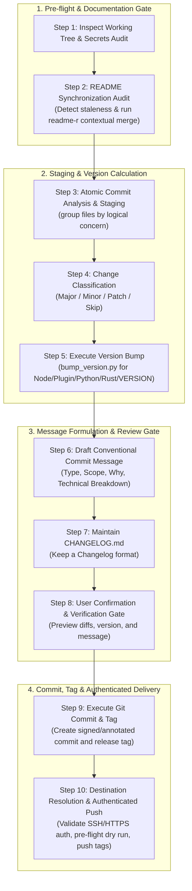

# Commiter Skill

<p align="center">
  <strong>Intelligent Git workflow automation: atomic staging, Conventional Commits, multi-ecosystem SemVer, secret leak prevention, README synchronization, and authenticated remote push management.</strong>
</p>

<p align="center">
  
  
  
  
  
</p>

---

## Table of Contents

- [Overview](#overview)
- [Key Features](#key-features)
- [Workflow Architecture](#workflow-architecture)
- [Project Structure](#project-structure)
- [Installation & Setup](#installation--setup)
- [Usage & Examples](#usage--examples)
- [Version Bumper CLI](#version-bumper-cli)
- [Environment & Security Hygiene](#environment--security-hygiene)
- [References & Specifications](#references--specifications)
- [License](#license)

---

## Overview

The **Commiter Skill** (`commiter`) is a structured, production-ready Git automation skill designed for AI coding agents and human developers. It standardizes the end-to-end version control lifecycle: from inspecting changes and preventing secret leaks, to validating README documentation synchronization, organizing atomic commits, calculating Semantic Version increments across language ecosystems, maintaining changelogs, and safely pushing to authenticated remote repositories.

In modern software engineering and agentic workflows, monolithic commits and unvetted pushes often introduce broken histories, sensitive credential leaks, or untracked releases. The Commiter Skill establishes a rigorous, fail-safe runbook with explicit confirmation gates, ensuring that every commit is atomic, descriptive, traceable, and secure.

---

## Key Features

- **Secret & Environment Hygiene Audits**: Automatically verifies `.gitignore` protection against `.env`, certificates (`*.pem`, `*.key`), and `credentials.json`. Blocks accidental staging of sensitive files before commit or push.
- **README Synchronization Gate**: Integrates with `readme-r` to audit documentation staleness before staging. Ensures new features, dependencies, or environment variables are documented before commits or tags are generated.
- **Atomic Commit Decomposition**: Intelligently groups disparate changes (e.g., bug fixes vs. feature additions) into separate, focused commits rather than sweeping entire trees into messy single commits.
- **Strict Conventional Commits (v1.0.0)**: Generates highly detailed commit messages with imperative subjects, deep "why" problem statements, and itemized technical component breakdowns.
- **Multi-Ecosystem Semantic Versioning 2.0.0**: Bundles a standalone Python helper script (`scripts/bump_version.py`) capable of parsing and incrementing version numbers in `package.json` (Node.js), `plugin.json` (Antigravity Plugins), `pyproject.toml` (Python), `Cargo.toml` (Rust), and `VERSION` files.
- **Automated Changelog Maintenance**: Updates `CHANGELOG.md` adhering to the [Keep a Changelog](https://keepachangelog.com/) standard, classifying changes into *Added*, *Changed*, *Fixed*, *Deprecated*, *Removed*, *Security*, and *Breaking Changes*.
- **Interactive Preview & Approval Gate**: Displays staged files, version bump diffs, and formatted commit messages for review prior to executing git commands.
- **Remote Destination & Auth Control**: Resolves remotes (`origin`, `upstream`), tests SSH and HTTPS authentication protocols (via `ssh -T` and `gh auth status`), executes non-destructive dry-run pushes, and manages atomic pushes with annotated tags (`--follow-tags`).

---

## Workflow Architecture

The Commiter skill executes an end-to-end 10-step operational pipeline organized into four distinct phases:



---

## Project Structure

```text
skills/commiter/
├── README.md                       # Comprehensive skill documentation
├── SKILL.md                        # Master skill definition and execution runbook
├── references/                     # Detailed architectural specifications and guidelines
│   ├── conventional_commits.md     # Conventional Commits v1.0.0 specifications & types
│   ├── readme_sync_integration.md  # Protocol for README audit and pre-commit coordination
│   ├── remote_auth_env.md          # Remote management, SSH/HTTPS auth protocols, secret safety
│   └── semver_rules.md             # SemVer 2.0.0 mapping rules & CHANGELOG.md maintenance
└── scripts/                        # Automated utility tooling
    └── bump_version.py             # Universal multi-ecosystem SemVer bumper CLI
```

---

## Installation & Setup

### Prerequisites

- **Git**: `>= 2.0`
- **Python**: `>= 3.8` (standard library only; zero third-party dependencies)
- **Optional CLI Tools**: [GitHub CLI (`gh`)](https://cli.github.com/) for HTTPS credential verification

---

## Usage & Examples

### Invoking with AI Coding Assistants

Simply invoke the skill via slash command or conversational request:

- `/commiter`
- *"Review my unstaged changes, synchronize documentation, and create atomic commits."*
- *"Bump the minor version, update CHANGELOG.md, and commit with a Conventional Commit message."*
- *"Check authentication and safely push the latest release tags to origin."*

---

## Version Bumper CLI

The bundled [`scripts/bump_version.py`](./scripts/bump_version.py) provides zero-dependency SemVer management across Node.js, Antigravity plugins, Python, Rust, and plain-text version files.

```bash
# Check current project version
python3 skills/commiter/scripts/bump_version.py --check

# Test bumping patch version in dry-run mode
python3 skills/commiter/scripts/bump_version.py --bump patch --dry-run

# Bump minor version in JSON mode
python3 skills/commiter/scripts/bump_version.py --bump minor --json
```

---

## Environment & Security Hygiene

### Protected Credentials & Ignore Rules

To prevent accidental data exfiltration or secrets leaking into version control, ensure your repository's `.gitignore` contains:

```gitignore
# Environment Variables & Secrets
.env
.env.*
!.env.example
*.pem
*.key
credentials.json
```

### Pre-Push Secret Verification

Before executing any push, run the audit check to verify no sensitive files are tracked:

```bash
git ls-files | grep -E '\.env$|\.key$|\.pem$|credentials\.json$'
```

---

## References & Specifications

- [Master Skill Runbook (`SKILL.md`)](./SKILL.md): Comprehensive step-by-step instructions for AI agents.
- [README Synchronization Integration Guide](./references/readme_sync_integration.md): Coordination protocol between `commiter` and `readme-r`.
- [Conventional Commits Specification](./references/conventional_commits.md): Types, scopes, imperative subjects, and breaking change rules.
- [Semantic Versioning Rules & Changelog Maintenance](./references/semver_rules.md): SemVer 2.0.0 decision matrix and Keep a Changelog mapping standards.
- [Remote Authentication, Environment & Push Management](./references/remote_auth_env.md): SSH and HTTPS authentication diagnostics, secret auditing, and safe push commands.

---

## License

This project is licensed under the [MIT License](https://opensource.org/licenses/MIT).
