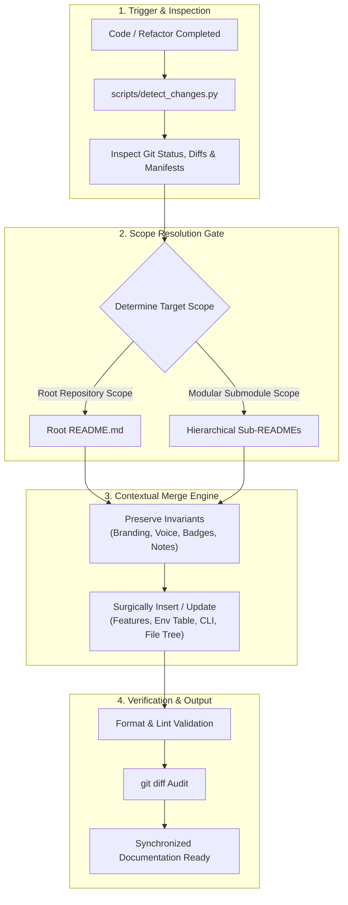

# readme-r

<p align="center">
  <strong>Autonomous README synchronization and contextual maintenance skill for AI coding agents and human developers.</strong>
</p>

<p align="center">
  
  
  
  
</p>

---

## Table of Contents

- [Overview](#overview)
- [Key Capabilities](#key-capabilities)
- [Pipeline Architecture](#pipeline-architecture)
- [Package Structure](#package-structure)
- [Installation & Setup](#installation--setup)
- [Usage & CLI Reference](#usage--cli-reference)
- [Companion Ambient Rule](#companion-ambient-rule)
- [License](#license)

---

## Overview

**`readme-r`** is a specialized documentation synchronization skill designed to eliminate documentation drift in fast-paced software development and agentic pair programming.

During continuous code changes, API routes shift, configuration variables are introduced, and dependencies evolve, but repository `README.md` files are frequently overlooked. `readme-r` pairs an automated repository change-detection script with an intelligent contextual merging engine. It automatically identifies altered components and surgically updates project documentation without clobbering human-authored tone, brand voice, or custom layouts.

---

## Key Capabilities

- **Autonomous Self-Execution**: Couples with ambient agent rules ([`rules/AGENTS.md`](../../rules/AGENTS.md)) to automatically audit and update documentation after code changes.
- **Contextual Merging Engine**: Surgically updates features, environment configuration tables, CLI flags, and directory trees while strictly preserving human branding, tone, badges, and custom callouts.
- **Hierarchical Documentation**: Coordinates both root repository `README.md` files and nested submodule/package READMEs across monorepos and multi-package layouts (`packages/*`, `services/*`, `apps/*`, `skills/*`).
- **Fast Change Detection**: Bundles a zero-dependency Python utility ([`scripts/detect_changes.py`](./scripts/detect_changes.py)) that inspects git status, diffs, package manifests (`package.json`, `pyproject.toml`, `Cargo.toml`, `go.mod`), and environment files.
- **Modern GitHub Standards**: Includes an enterprise-grade GitHub template ([`resources/standard_template.md`](./resources/standard_template.md)) featuring subgraphs, structured tables of contents, and configuration matrices.

---

## Pipeline Architecture

The synchronization workflow processes changes through four distinct operational phases:



---

## Package Structure

```text
readme-r/
├── README.md                          # Skill overview and documentation
├── SKILL.md                           # Master skill definition and execution runbook
├── references/
│   └── doc_guidelines.md              # Contextual merge principles & style standards
├── resources/
│   └── standard_template.md           # Modern GitHub README blueprint
└── scripts/
    └── detect_changes.py              # Repository inspector and diff analyzer CLI
```

---

## Installation & Setup

### 1. Bundled with `git-release-toolkit` (Recommended)

`readme-r` is bundled directly within the **Git & Release Toolkit** plugin:

```bash
git clone https://github.com/kemaltombul/git-release-toolkit.git ~/.gemini/config/plugins/git-release-toolkit
```

Once installed, the ambient rule in `rules/AGENTS.md` automatically activates `readme-r` for relevant code changes.

### 2. Standalone Workspace Installation

To use `readme-r` as a project-local skill without the full plugin:

```bash
mkdir -p .agents/skills/readme-r
cp -r /path/to/readme-r/* .agents/skills/readme-r/
```

---

## Usage & CLI Reference

### Change Detection Helper

Run the inspector directly from your terminal to analyze pending modifications:

```bash
# Human-readable summary
python3 skills/readme-r/scripts/detect_changes.py

# Machine-readable JSON output
python3 skills/readme-r/scripts/detect_changes.py --json

# Inspect a specific target directory
python3 skills/readme-r/scripts/detect_changes.py --dir /path/to/repo --json
```

#### CLI Options

| Flag | Type | Description |
| :--- | :--- | :--- |
| `--dir <path>` | `string` | Target directory to inspect (defaults to current directory) |
| `--json` | `flag` | Output machine-readable JSON structure |
| `-h`, `--help` | `flag` | Display available help and arguments |

### JSON Output Schema

When invoked with `--json`, `detect_changes.py` outputs structured metadata:

```json
{
  "is_git_repository": true,
  "total_changed_files": 2,
  "changed_files": ["src/api.py", "package.json"],
  "git_status": {
    "modified": ["src/api.py", "package.json"],
    "added": [],
    "deleted": [],
    "untracked": []
  },
  "has_dependency_changes": true,
  "has_new_files_or_modules": false,
  "has_configuration_changes": false,
  "target_readmes": {
    "root_readme": {
      "path": "/workspace/README.md",
      "exists": true
    },
    "hierarchical_readmes": {}
  },
  "manifests": {
    "package.json": {
      "dependencies": { "express": "^4.19.2" }
    }
  },
  "diff_snippet": "..."
}
```

---

## Companion Ambient Rule

The ambient rule in [`rules/AGENTS.md`](../../rules/AGENTS.md) triggers the `readme-r` workflow automatically whenever:

1. **New or Modified Functionality**: New features, updated API routes, CLI arguments, or changed component behaviors.
2. **Dependency & Environment Updates**: Added or removed packages in manifests (`package.json`, `pyproject.toml`, `Cargo.toml`, `go.mod`) or changed `.env` keys.
3. **Structural Changes**: New submodules, packages, or services created under `packages/`, `services/`, `apps/`, or `skills/`.
4. **Behavioral Refactors**: Architectural changes altering how developers run, test, build, or deploy.

---

## License

This project is licensed under the [MIT License](https://opensource.org/licenses/MIT).
