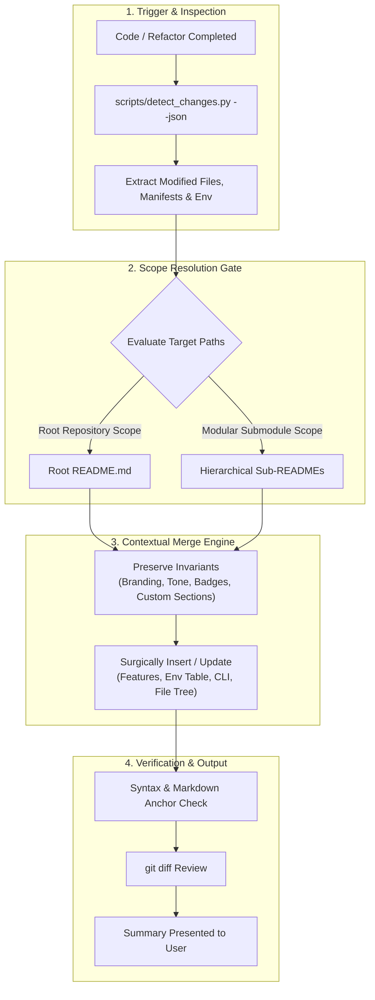

# `readme-r`: Automatic README Synchronization Runbook

This skill provides an automated, structured runbook for keeping `README.md` files synchronized with repository changes. It preserves existing voice and human-authored prose, manages hierarchical sub-READMEs in modular projects, and generates comprehensive front-pages for new modules.

---

## Table of Contents

- [Execution Workflow](#execution-workflow)
- [Step 1: Inspect Repository Modifications](#step-1-inspect-repository-modifications)
- [Step 2: Resolve Target README Scope](#step-2-resolve-target-readme-scope)
- [Step 3: Execute Contextual Merging](#step-3-execute-contextual-merging)
- [Step 4: Verify Formatting & Diff](#step-4-verify-formatting--diff)
- [Step 5: Report Documentation Summary](#step-5-report-documentation-summary)
- [Ambient Rule Integration](#ambient-rule-integration)

---

## Execution Workflow



---

## Step 1: Inspect Repository Modifications

Execute the bundled change detector script to inspect modified files, git diffs, package manifests, and newly added directories:

```bash
# Locate detector:
# 1. Local skill: skills/readme-r/scripts/detect_changes.py
# 2. Plugin root: ~/.gemini/config/plugins/git-release-toolkit/skills/readme-r/scripts/detect_changes.py
python3 skills/readme-r/scripts/detect_changes.py --json
```

**Key Information to Extract:**
1. **Modified Files**: Which specific components, routes, or utilities changed?
2. **Dependency Manifests**: Were packages added or removed in `package.json`, `pyproject.toml`, `Cargo.toml`, `go.mod`, etc.?
3. **Environment Changes**: Were new environment variables introduced in `.env`, `.env.example`, or config files?
4. **Target README Locations**: Determine whether updates affect the root `README.md`, sub-module READMEs, or both.

---

## Step 2: Resolve Target README Scope

Consult [doc_guidelines.md](./references/doc_guidelines.md) for hierarchical rules:

1. **Root README**:
   - **Path**: `README.md` in repository root.
   - **Scope**: Repository-wide architecture, global features, quick start, prerequisites, and submodule directory map.
2. **Hierarchical Sub-READMEs**:
   - **Paths**: `<submodule>/README.md` (e.g. `packages/<pkg>/README.md`, `services/<svc>/README.md`, `apps/<app>/README.md`, `skills/<skill>/README.md`).
   - **Scope**: Package-specific APIs, local commands, isolated setup, and scoped examples.
   - **Creation Rule**: If a new submodule, package, or service was created, generate a dedicated `README.md` in that folder using the standard template. If an existing submodule was altered, update its local `README.md`.

---

## Step 3: Execute Contextual Merging

### Scenario A: Existing `README.md` (Intelligent Contextual Merge)
Do **not** overwrite the whole file. Follow the contextual merge protocol:
- **Preserve**: Keep project title, branding, badges, mission statement, custom callouts, existing ordering, and untouched human-authored sections.
- **Update / Insert**:
  - **Features**: Append bullet points for new capabilities; update descriptions for modified behaviors.
  - **Quick Start / Prerequisites**: Update runtime versions or required dependencies if new ones were introduced.
  - **Usage & Examples**: Update or add realistic code snippets demonstrating new functions, CLI flags, or API endpoints.
  - **Configuration**: Synchronize the environment variables table with `.env.example`.
  - **Commands**: Add new lifecycle scripts or CLI command options.
  - **Architecture / Directory Tree**: Update file tree or Mermaid diagram if new directories were created.

### Scenario B: New or Missing `README.md`
If no README exists, use [`resources/standard_template.md`](./resources/standard_template.md) as the blueprint. Populate:
- Project title, concise tagline, and status badges.
- Table of Contents with working anchor links.
- Core features and problem statement.
- Multi-tier Mermaid architecture diagram and directory structure.
- Prerequisites, step-by-step installation, and environment setup.
- Working usage examples with syntax-highlighted code blocks.
- Configuration table and development/testing commands.
- License information.

---

## Step 4: Verify Formatting & Diff

1. Write the updated markdown content using standard edit/write tools.
2. Run `git diff` on the target README file(s) to verify:
   ```bash
   git diff README.md
   ```
3. Audit checklist:
   - [ ] No emoji clutter in section headings.
   - [ ] Clean markdown syntax and valid language tags (`bash`, `typescript`, `python`, `json`, `yaml`).
   - [ ] Table of Contents anchor links match corresponding headings.
   - [ ] Untouched human-authored sections remain intact.

---

## Step 5: Report Documentation Summary

Following the **Preview & Apply** approach:
1. Provide a concise, bulleted summary of the sections that were updated or created.
2. Highlight any newly documented environment variables, commands, or API features.
3. Show a brief diff excerpt or section preview so the user can quickly confirm the documentation matches their expectations.

---

## Ambient Rule Integration

The ambient rule in [`rules/AGENTS.md`](../../rules/AGENTS.md) enforces this runbook across all conversations. Whenever code, package manifests, or project structures change, this skill must be evaluated before concluding the turn.
