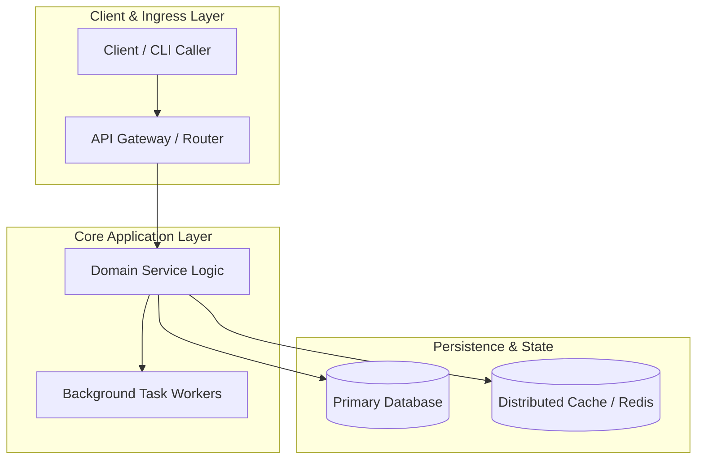

# Standard Comprehensive README Template (Modern GitHub Standard)

Use this template as the foundational blueprint when generating a new `README.md` from scratch or when restructuring a minimal README into a comprehensive, professional project front-page.

```markdown
# <Project Name>

<p align="center">
   Logo" width="120" />
</p>

<p align="center">
  <strong><Short, punchy one-sentence elevator pitch describing the project's core value></strong>
</p>

<p align="center">
  -blue.svg?style=flat-square" alt="Version" />
  -green.svg?style=flat-square" alt="License" />
  
  
</p>

---

## Table of Contents

- [Overview](#overview)
- [Key Features](#key-features)
- [System Architecture](#system-architecture)
- [Directory Structure](#directory-structure)
- [Quick Start](#quick-start)
  - [Prerequisites](#prerequisites)
  - [Installation](#installation)
- [Usage & Examples](#usage--examples)
- [Configuration](#configuration)
- [Development & Testing](#development--testing)
- [Contributing](#contributing)
- [License](#license)

---

## Overview

<2-3 concise paragraphs providing an executive overview of the project, problem statement solved, and target audience or runtime ecosystem.>

---

## Key Features

- **<Feature 1 Name>**: <Concise explanation of feature capability and value.>
- **<Feature 2 Name>**: <Concise explanation of feature capability and value.>
- **<Feature 3 Name>**: <Concise explanation of feature capability and value.>
- **<Feature 4 Name>**: <Concise explanation of feature capability and value.>

---

## System Architecture

<Brief sentence describing the design pattern, modular breakdown, or system flow.>



---

## Directory Structure

```text
├── src/                               # Primary application source code
│   ├── components/                    # Reusable UI/logic components
│   ├── services/                      # Core business logic and integrations
│   └── utils/                         # Shared utility helpers
├── tests/                             # Unit, integration, and e2e test suites
├── docs/                              # In-depth architectural guides and specifications
└── package.json                       # Dependencies, lifecycle scripts, and metadata
```

---

## Quick Start

### Prerequisites

Ensure you have the following installed locally:
- [Node.js](https://nodejs.org/) `>= 18.0.0` (or Python `>= 3.10`, Rust `>= 1.70`, Go `>= 1.21`)
- Package manager: `npm` / `pnpm` / `bun` / `poetry` / `cargo`

### Installation

1. **Clone the repository:**
   ```bash
   git clone <repo_url>
   cd <project_name>
   ```

2. **Install dependencies:**
   ```bash
   npm install
   # or: pip install -r requirements.txt
   ```

3. **Configure environment:**
   ```bash
   cp .env.example .env
   # Edit .env with your required credentials
   ```

4. **Launch development server:**
   ```bash
   npm run dev
   ```

---

## Usage & Examples

### Basic Example

```javascript
import { Client } from '<package-name>';

const client = new Client({ apiKey: process.env.API_KEY });
const result = await client.execute({ query: 'hello' });
console.log(result);
```

### CLI Commands (If Applicable)

| Command | Description | Example |
| :--- | :--- | :--- |
| `<cmd> start` | Starts service daemon | `<cmd> start --port 8080` |
| `<cmd> sync` | Synchronizes local state | `<cmd> sync --force` |

---

## Configuration

Key environment variables required or supported:

| Variable | Type | Default | Description |
| :--- | :--- | :--- | :--- |
| `PORT` | `number` | `3000` | Port for the HTTP server |
| `DATABASE_URL` | `string` | - | Connection string for database |
| `NODE_ENV` | `string` | `development` | Runtime environment mode |

---

## Development & Testing

Run common development tasks:

```bash
# Run unit tests
npm test

# Run linter & formatter
npm run lint
npm run format

# Build production bundle
npm run build
```

---

## Contributing

Contributions, issues, and feature requests are welcome! Feel free to check the [issues page](<repo_issues_url>).

1. Fork the project
2. Create your feature branch (`git checkout -b feat/amazing-feature`)
3. Commit your changes (`git commit -m 'feat: add amazing feature'`)
4. Push to the branch (`git push origin feat/amazing-feature`)
5. Open a Pull Request

---

## License

This project is licensed under the terms of the [<License Name>](./LICENSE) license.
```
